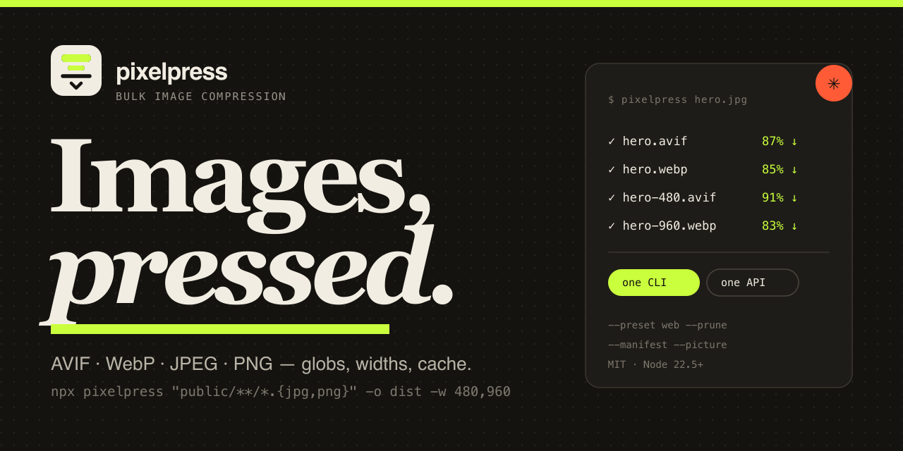

# pixelpress

<p align="center">
  
</p>

<p align="center">
  
</p>

[](https://github.com/aotr/pixelpress/actions/workflows/ci.yml)
[](https://aotr.github.io/pixelpress/)
[](https://www.npmjs.com/package/pixelpress)
[](LICENSE)

**Docs and demos: [aotr.github.io/pixelpress](https://aotr.github.io/pixelpress/)**

**Bulk image compression and transcoding.** Point it at a file, a folder, or a
glob; get AVIF, WebP, JPEG, or PNG at responsive widths with sensible quality,
a cache, a manifest, an HTML report, and ready-to-paste `<picture>` snippets.

```bash
npx pixelpress "public/images/**/*.{jpg,png}" -o dist/images \
  -f avif,webp -w 480,960,1920 --hash --manifest dist/images.json
```

```
pixelpress 42 files → /app/dist/images (avif,webp)
  ✓ hero.jpg              1.4 MB → 182.3 KB  87% smaller
  ✓ team/ana.png          420.1 KB → 61.8 KB  85% smaller
  ✓ products/chair.webp   118.4 KB → 44.2 KB  63% smaller

42 files · 126 outputs · 18.2 MB → 3.1 MB (83% smaller) · 4.2s
```

Node.js 22.5+. One runtime dependency: `sharp`.

## Install

```bash
# use it without installing
npx pixelpress --help

# or add it to the project
npm install --save-dev pixelpress
```

## Quick start

```bash
# One image, three next-gen sizes
pixelpress hero.jpg -o dist -w 480,960,1920

# A whole tree, recursively, keeping folder structure
pixelpress public/images -o dist/images -r

# Start from a preset and override one thing
pixelpress photos -o dist -r --preset web --widths 640,1280

# Every JPEG/PNG below assets/, but skip drafts
pixelpress "assets/**/*.{jpg,png}" -o dist/assets \
  --include "products/**" --exclude "*-draft.*"

# Fit a hard budget per variant, hash filenames, cache the results
pixelpress photos -o dist -r --max-bytes 120kb --hash --cache

# Rebuild on change
pixelpress photos -o dist -r --watch

# Generate markup that points at the output
pixelpress photos -o dist -r -w 480,960,1600 \
  --picture dist/picture.html --public-path /images

# A visual before/after report
pixelpress photos -o dist -r --report dist/report.html

# One image through a pipe
cat photo.jpg | pixelpress - -f webp --stdout > photo.webp
```

Output mirrors the input by default:

```
public/images/                 dist/images/
  hero.jpg                       hero.avif
  team/ana.png                   hero.webp
                                 team/ana.avif
                                 team/ana.webp
```

With `--widths`, the rendered width is appended: `hero-480.avif`,
`hero-960.avif`. Widths larger than the source are dropped unless `--enlarge`
is set.

## Why pixelpress?

It started as a rewrite of
[SudiptoImgTranscode](https://www.npmjs.com/package/sudipto-img-transcode) —
same job, none of the sharp edges: any input format, recursive and glob inputs,
per-format quality, responsive widths, a real API, visible failures, alpha
handling, EXIF orientation, and tests.

It now borrows the best ideas from the tools people already use:
[sharp-cli](https://www.npmjs.com/package/sharp-cli) (transforms, globs),
[imagemin-cli](https://www.npmjs.com/package/imagemin-cli) (batch output),
[Squoosh CLI](https://www.npmjs.com/package/@squoosh/cli) (per-codec options,
suffix, size optimization),
[vite-imagetools](https://www.npmjs.com/package/vite-imagetools) (srcset), and
[@11ty/eleventy-img](https://www.npmjs.com/package/@11ty/eleventy-img)
(responsive output sets). See [COMPARISON.md](COMPARISON.md) for the matrix and
what was adopted.

## CLI reference

### Input and bulk

| Option | Default | Description |
| --- | --- | --- |
| `<file\|dir\|glob...>` | required | Files, directories, or quoted globs. |
| `-r, --recursive` | off | Include subdirectories of directory inputs. |
| `--include <glob>` | all | Only process matching files; repeatable. |
| `--exclude <glob>` | none | Skip matching files; repeatable. |
| `--follow-symlinks` | off | Follow symlinked files and directories. |
| `-c, --config <file>` | auto | JSON or ESM config. Auto-loads `pixelpress.config.json` if present. |

Globs are expanded by Node, not the shell, so quote them:
`"public/**/*.{jpg,png}"`. Include/exclude patterns match the path relative to
the input root and the basename, so `--include "*.jpg"` catches nested JPEGs
too. Patterns are matched with Node's glob semantics (`*`, `**`, `?`, `[...]`,
`{a,b}`).

With multiple directory/glob roots, outputs are prefixed by each root's
basename to avoid collisions. `--flat` drops the tree and uses basenames
(collisions are reported, never silently overwritten).

### Output and naming

| Option | Default | Description |
| --- | --- | --- |
| `-o, --out <dir>` | `pixelpress-out` | Output directory. |
| `-f, --formats <list>` | `avif,webp` | Any of `avif,webp,jpeg,png` (or `jpg`). |
| `--preset <name>` | none | `web`, `thumb`, `social`, or `lossless`. |
| `-w, --widths <list>` | source size | Responsive widths, e.g. `480,960,1920`. |
| `--width <px>` | none | Single resize width (not with `--widths`). |
| `--height <px>` | none | Single resize height (not with `--widths`). |
| `--fit <mode>` | `inside` | `cover`, `contain`, `fill`, `inside`, `outside`. |
| `--position <pos>` | `center` | Crop gravity, e.g. `attention`, `entropy`, `right top`. |
| `--enlarge` | off | Allow upscaling. |
| `--prefix <text>` | none | Prepend to filenames. |
| `--suffix <text>` | none | Append to filenames. |
| `--hash` | off | Append an 8-character SHA-256 content hash. |
| `--flat` | off | Flatten the output tree. |
| `--clean` | off | Delete the output directory before writing. |
| `--preserve-dates` | off | Copy source timestamps onto outputs. |

Name order: `<prefix><name><suffix>[-<width>][-<hash>].<ext>`. For example
`pre-hero-2x-960-a1b2c3d4.avif`. `--flat`, `--prefix`, and `--suffix` never
escape the output directory.

### Transforms

| Option | Description |
| --- | --- |
| `--rotate <deg>` | Rotate by degrees. This overrides EXIF auto-orientation. |
| `--no-auto-orient` | Ignore EXIF orientation (on by default). |
| `--flip` / `--flop` | Flip vertically / horizontally. |
| `--grayscale` | Convert to grayscale. |
| `--blur <sigma>` | Gaussian blur. |
| `--sharpen <sigma>` | Sharpen; `1` is a good starting point. |
| `--normalize` | Stretch contrast across the full range. |
| `--gamma <value>` | Gamma correction. |
| `--tint <color>` | Tint while preserving luminance. |
| `--trim <threshold>` | Trim uniform borders (1-100). |
| `--extract <WxH+X+Y>` | Crop a region, e.g. `800x600+100+50`. |
| `--extend <edges>` | Pad: `10`, `10,20`, or `10,20,30,40` (top,right,bottom,left). |
| `--density <dpi>` | Rasterization density for SVG input. |

### Encoding

| Option | Default | Description |
| --- | --- | --- |
| `-q, --quality <value>` | per format | A number 1-100, or `avif=50,webp=72`. |
| `--effort <value>` | avif 4, webp 4, png 10 | A number or `avif=6,webp=4,png=10`. |
| `--lossless` | off | Lossless AVIF/WebP/PNG. JPEG is rejected. |
| `--progressive` | on | Progressive JPEG. |
| `--no-progressive` | — | Baseline JPEG. |
| `--chroma-subsampling <s>` | `4:2:0` | `4:2:0`, `4:2:2`, or `4:4:4` (JPEG). |
| `--alpha-quality <n>` | 100 | WebP alpha quality. |
| `--palette` / `--no-palette` | auto | Force or disable PNG quantization. |
| `--compression-level <n>` | 9 | PNG zlib level 0-9. |
| `--max-bytes <size>` | none | Lower quality until each variant fits, e.g. `150kb`. |
| `--background <color>` | `#ffffff` | Matte for transparent JPEGs. |
| `--keep-metadata` | off | Keep EXIF/ICC instead of stripping. |

Default quality is AVIF 55, WebP 78, JPEG 80, PNG 80. PNG quantizes to a
palette below quality 100; use `--quality png=100` for lossless PNG, or
`--lossless`.

`--max-bytes` is a **per variant** budget. It first tries your requested
quality, then binary-searches down. If even quality 1 cannot fit, that file is
reported as failed instead of writing an oversized output. Lossless and
`--max-bytes` cannot be combined.

### Workflow

| Option | Default | Description |
| --- | --- | --- |
| `--manifest <file>` | none | Write a JSON report of every variant. |
| `--picture <file>` | none | Write `<picture>` snippets for every input. |
| `--report <file>` | none | Write a self-contained visual HTML report. |
| `--public-path <path>` | `/` | URL prefix used in snippets. |
| `--sizes <value>` | `100vw` | `sizes` attribute used in snippets. |
| `--lqip` | off | Add a tiny WebP data-URI placeholder + dominant color. |
| `--cache` | on | Reuse cached outputs. |
| `--cache-dir <dir>` | `node_modules/.cache/pixelpress` | Cache location. |
| `--no-cache` | — | Disable the cache. |
| `--prune` | off | Delete outputs recorded in the cache that are no longer produced. |
| `--force` | off | Re-encode even when the cache is valid. |
| `--fail-fast` | off | Stop after the first failed file. |
| `--concurrency <n>` | 4 | Files processed in parallel. |
| `--dry-run` | off | Show the plan; write nothing. |
| `--stdout` | off | Write one encoded image to stdout. |
| `--json` | off | Print the full report as JSON. |
| `--quiet` | off | Only print the summary. |
| `--verbose` | off | Print every variant. |
| `--watch` | off | Re-run when inputs change. |
| `--init` | off | Create a starter `pixelpress.config.json`. |
| `-h, --help`, `-v, --version` | | |

Some flags take values beginning with `-` (for example a suffix of `-2x`); use
the `--flag=value` form, e.g. `--suffix=-2x`.

## Presets

Presets are starting points; any explicit flag overrides them. For example,
`--preset web --widths 640,1280` keeps the WebP/AVIF qualities but replaces the
responsive widths.

| Preset | Formats | Size | Defaults |
| --- | --- | --- | --- |
| `web` | AVIF, WebP | widths 480, 960, 1920 | AVIF 50, WebP 72 |
| `thumb` | WebP | width 400 | WebP 72 |
| `social` | JPEG, WebP | 1200 × 630 cover | JPEG 82, WebP 78 |
| `lossless` | PNG, WebP | original size | lossless, PNG palette off |

```bash
pixelpress products -o dist -r --preset web
pixelpress og.jpg -o social --preset social
pixelpress icons -o dist -r --preset lossless
```

Presets work in the config file and API too.

## Config file

Create a starter config with sensible defaults:

```bash
pixelpress --init
```

That writes `pixelpress.config.json` with a `$schema` reference, the `web`
preset, an input glob, `outDir`, cache, and prune enabled. The schema is
published at `node_modules/pixelpress/pixelpress.schema.json` for editor
completion.

Put defaults in `pixelpress.config.json` and run `pixelpress` with no inputs:

```json
{
  "$schema": "./node_modules/pixelpress/pixelpress.schema.json",
  "preset": "web",
  "inputs": ["src/images/**/*.{jpg,png}"],
  "outDir": "public/images",
  "formats": ["avif", "webp"],
  "widths": [480, 960, 1920],
  "quality": { "avif": 50, "webp": 72 },
  "recursive": true,
  "cache": true,
  "cacheDir": "node_modules/.cache/pixelpress",
  "prune": true,
  "lqip": true,
  "manifest": "public/images.json",
  "picture": "src/_includes/picture.html",
  "report": "public/images-report.html",
  "publicPath": "/images",
  "sizes": "(max-width: 900px) 100vw, 900px"
}
```

The file is auto-detected in the current directory. Use
`--config other.config.json` for another path. `.mjs` and `.js` configs work
too:

```js
export default {
  inputs: ['assets'],
  outDir: 'dist/assets',
  formats: ['webp'],
};
```

CLI flags override config values. Config keys are the same as the
[API options](#api). Paths in a config are resolved relative to the current
working directory. JSON is recommended for portability.

`--watch` cannot be combined with `--json`, `--dry-run`, or `--clean`.
`--dry-run` writes neither images nor any requested manifest, picture, or
report file.

## Caching, pruning, and watch mode

The CLI enables a cache by default. It lives **outside the output directory**,
at `node_modules/.cache/pixelpress/cache-<hash>.json` (one file per output
directory), and stores each input's mtime, size, and outputs, keyed by a
fingerprint of all encoding options. Changing quality, widths, transforms, or
formats invalidates skipping automatically.

```bash
pixelpress photos -o dist -r                    # first run: encodes
pixelpress photos -o dist -r                    # second run: cached
pixelpress photos -o dist -r --force            # ignore the cache
pixelpress photos -o dist -r --no-cache
pixelpress photos -o dist -r --cache-dir .cache # custom location
```

Older caches at `<outDir>/.pixelpress-cache.json` are read once and removed
after the next save. The `PIXELPRESS_CACHE_DIR` environment variable sets the
default location.

`--prune` deletes outputs recorded in the cache that are no longer produced —
for example after deleting a source, removing a format, or dropping a width:

```bash
pixelpress photos -o dist -r --prune
```

Pruning only removes regular files that the cache says are inside `--out`; it
never deletes inputs, outputs for files that failed this run, or files for
specs skipped by `--fail-fast`. Empty directories left behind are removed.
`--prune` requires the cache, and `--dry-run` does not delete anything.

Each image, report, manifest, picture file, and cache write goes through a
temporary file in the destination directory and an atomic rename. A crash or
Ctrl+C leaves the previous output intact instead of a half-written file.

`--watch` performs the initial run, then waits for image changes and re-runs
with the cache and prune setting. Output writes are ignored, so it does not
loop. Watches are recursive on platforms that support it; on other platforms
the input root is watched non-recursively.

Cache invalidation uses mtime + size, not content hashing, so replacing a file
with identical mtime and size will be treated as unchanged. Use `--force` in
CI or when in doubt.

## Naming, manifests, and `<picture>`

`--hash` appends a content hash, which is useful for immutable CDN caching:

```
pre-hero-2x-960-a1b2c3d4.avif
```

`--manifest` writes every input, variant, dimension, byte count, quality,
animation frame count, cache state, and ready-to-use `srcset` strings per
format. `--lqip` adds `placeholder` (a base64 WebP data URI) and
`dominantColor` to each file entry. Paths are relative to the current
directory.

```json
{
  "version": 4,
  "options": { "formats": ["avif", "webp"], "widths": [480], "...": "..." },
  "files": [
    {
      "input": "public/images/hero.jpg",
      "width": 2400,
      "height": 1600,
      "sourceBytes": 1436544,
      "cached": false,
      "dominantColor": "#6c7a89",
      "placeholder": "data:image/webp;base64,UklGR...",
      "outputs": [
        {
          "format": "avif",
          "path": "dist/images/hero-480.avif",
          "width": 480,
          "height": 320,
          "bytes": 14210,
          "quality": 55,
          "animated": false,
          "pages": 1
        },
        {
          "format": "webp",
          "path": "dist/images/hero-480.webp",
          "width": 480,
          "height": 320,
          "bytes": 22981,
          "quality": 72,
          "animated": false,
          "pages": 1
        }
      ],
      "srcset": {
        "avif": "dist/images/hero-480.avif 480w",
        "webp": "dist/images/hero-480.webp 480w"
      }
    }
  ],
  "skipped": [],
  "failed": [],
  "pruned": [],
  "pruneErrors": [],
  "totals": {
    "files": 1,
    "outputs": 2,
    "cached": 0,
    "pruned": 0,
    "pruneErrors": 0,
    "sourceBytes": 1436544,
    "outputBytes": 37191,
    "savedBytes": 1399353,
    "savedPercent": 97,
    "skipped": 0,
    "failed": 0,
    "durationMs": 342
  }
}
```

`--picture` writes markup like this, choosing the largest JPEG/PNG/WebP as the
fallback and adding the other formats as `<source>`:

```html
<!-- public/images/hero.jpg -->
<picture>
  <source type="image/avif" srcset="/images/hero-480.avif 480w, /images/hero-960.avif 960w" sizes="100vw">
  <source type="image/webp" srcset="/images/hero-480.webp 480w, /images/hero-960.webp 960w" sizes="100vw">
  
</picture>
```

Edit `alt` afterwards; snippets intentionally start with an empty value.

## HTML report

`--report` writes a self-contained page with every source and output side by
side, byte savings, dimensions, quality, frame counts, and cache state. It has
no external assets or network requests; open the file directly in a browser.

```bash
pixelpress photos -o dist -r --report dist/report.html
open dist/report.html
```

Previews link to files relative to the report, so the report can live next to
the output or elsewhere on disk. `--report` is skipped by `--dry-run` and
rewritten on every `--watch` run. It can be set as `report` in the config file.

## stdin and stdout

Use `-` as the input and `--stdout` (or `-o -`) for a single image through a
pipe. Logs go to stderr, so stdout is pure image data.

```bash
pixelpress photo.jpg -f avif --stdout > photo.avif
cat photo.jpg | pixelpress - -f webp --stdout > photo.webp
curl -s https://example.com/cat.jpg | pixelpress - -f webp -q 60 --stdout > cat.webp
```

In stream mode, use exactly one input and one format. `--formats` defaults to
`webp` here. Use `--width`/`--height` instead of `--widths`; all transforms,
quality/effort settings, `--max-bytes`, `--lossless`, and metadata options
apply. `--stdout` cannot be combined with an output directory (`-o` other than
`-`), `--watch`, `--clean`, `--dry-run`, `--json`, `--manifest`, `--picture`,
or `--report`.

## Animated images

Animated GIF and WebP inputs are supported:

- **WebP output preserves all frames**, including resized width variants.
- **AVIF, JPEG, and PNG output use the first frame** as a static fallback.
- `<picture>` snippets put the animated WebP source first, with a static
  format as the fallback.
- `--lqip` uses the first frame for its placeholder.

Use `-f webp` when animation must be preserved. Animated AVIF output is not
supported by the current sharp/libvips build; it is on the roadmap.

## API

```js
import { optimize, transcode } from 'pixelpress';

const report = await optimize(['public/images', 'static/**/*.png'], {
  outDir: 'dist/images',
  formats: ['avif', 'webp', 'jpeg'],
  widths: [480, 960, 1920],
  quality: { avif: 50, webp: 72 },
  recursive: true,
  include: ['*.jpg', '*.png'],
  exclude: ['*-draft.*'],
  cache: true,
  cacheDir: 'node_modules/.cache/pixelpress',
  prune: true,
  lqip: true,
  concurrency: 8,
});

console.log(report.totals.savedPercent, '% smaller');
console.log(report.totals.cached, 'files reused from cache');

for (const file of report.files) {
  for (const variant of file.outputs) {
    console.log(variant.format, variant.path, variant.width, variant.bytes);
  }
}
```

Every path in the API result is absolute. The cache is **off by default** in the
API; pass `cache: true` to enable it. `cacheDir` changes its location and
`prune: true` removes stale outputs (it requires `cache: true`). `preset`
accepts `web`, `thumb`, `social`, or `lossless`; explicit options override the
preset. `force`, `clean`, `failFast`, and all transforms accept the same names
as the CLI.

Single image, buffer in and buffer out:

```js
import { transcode } from 'pixelpress';

const { data, info } = await transcode('upload.jpg', {
  format: 'avif',
  width: 800,
  quality: 50,
  maxBytes: 90_000,
  grayscale: true,
  keepMetadata: false,
});

await fs.writeFile('upload.avif', data);
// info = { format, width, height, bytes, quality, sourceWidth, sourceHeight }
```

`transcode` accepts a filesystem path, `Buffer`, or `Uint8Array` and applies the
same transforms, format tuning, and size budget as `optimize`.

## Hooks

API and JS-config only. `beforeEncode` receives the sharp pipeline before
encoding — mutate it in place or return a replacement. `afterEncode` receives
the final bytes and can return a `Buffer` to replace them. Both may be async.

```js
import { optimize } from 'pixelpress';

const report = await optimize(['public/images'], {
  outDir: 'dist/images',
  formats: ['webp'],
  hooks: {
    // Watermark every variant before it is encoded.
    beforeEncode: (pipeline) => pipeline.composite([
      { input: 'assets/mark.png', gravity: 'southeast' },
    ]),
    // Inspect or rewrite the encoded bytes. Runs once per variant,
    // after any maxBytes search.
    afterEncode: async ({ data, info }, { format, width }) => {
      console.log(format, width, data.length);
    },
  },
});
```

Hooks are part of the cache fingerprint: changing a hook re-encodes, and
`afterEncode` replacements are what gets written, cached, hashed, and pruned.

## Releasing

CI runs on Node 22 and 24 for Linux and macOS. For a release with npm
provenance, configure this repository as a trusted publisher on npmjs.com:

1. npmjs.com → package **pixelpress** → **Settings** → **Trusted publishing**.
2. Choose **GitHub Actions**, repository `aotr/pixelpress`, workflow
   `publish.yml`.
3. Run the **Publish** workflow from the Actions tab.

The workflow runs the test suite, then `npm publish --access public
--provenance` using OIDC. No long-lived npm token is stored in GitHub. Local
publishing still works with `npm publish --access public`; the manual workflow
is intentionally not triggered by tags until trusted publishing is configured.

## Behavior and limits

- **Never overwrites the input.** Output that resolves to an input file is
  refused; `--out` cannot equal a directory input.
- **No upscaling** unless `--enlarge`. Responsive widths above the source are
  dropped.
- **Output collisions are errors**, not silent overwrites.
- **Writes are atomic**: images, reports, manifests, picture files, and caches
  are written to a temp file and renamed, so a crash cannot leave a partial
  final file.
- **Stale outputs can be pruned** with `--prune`, using the cache's output
  index. Failed files and inputs outside the current run are handled safely.
- **Failed multi-format runs roll back** newly created outputs for that file;
  files that already existed before the run keep their new version.
- **Per-file failures do not stop the run** unless `--fail-fast`; the CLI exits
  `1` if anything failed.
- **Metadata is stripped by default** (including GPS); pass `--keep-metadata`
  to retain EXIF/ICC. EXIF orientation is applied even when metadata is stripped.
- **Transparent JPEGs** are flattened onto `--background`.
- **Animated GIF/WebP inputs** preserve frames in WebP; AVIF/JPEG/PNG use the
  first frame as a static fallback.
- **SVG inputs are rasterized**, not minified. Run SVGO first if you need that.
- **`--clean` is guarded**: it refuses the filesystem root, the home directory,
  the current directory, ancestors of the current directory, and any directory
  containing an input.
- **No stale cache surprises**: the fingerprint covers every option that
  affects pixels or output paths.

## Development

```bash
npm install
npm test
```

`PLAN.md` has the roadmap; `COMPARISON.md` shows how the feature set compares
with sharp-cli, imagemin-cli, Squoosh CLI, vite-imagetools, and eleventy-img.

## License

MIT
